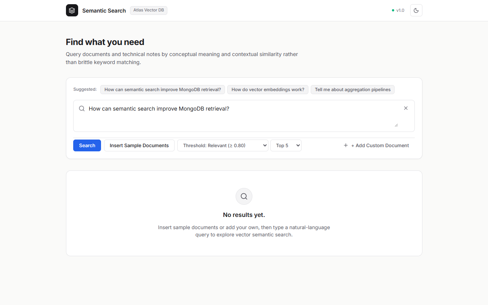
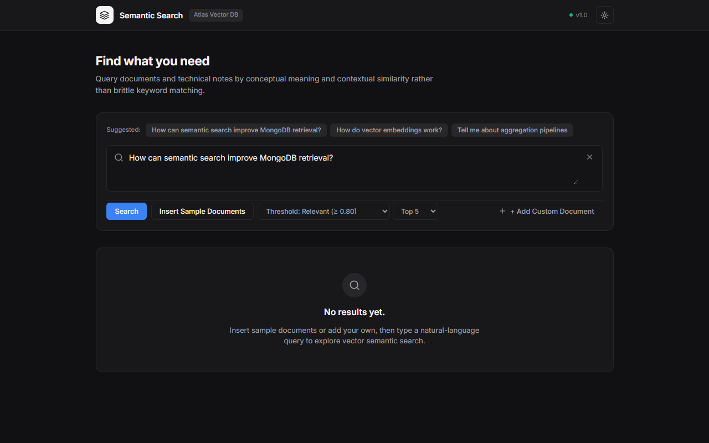
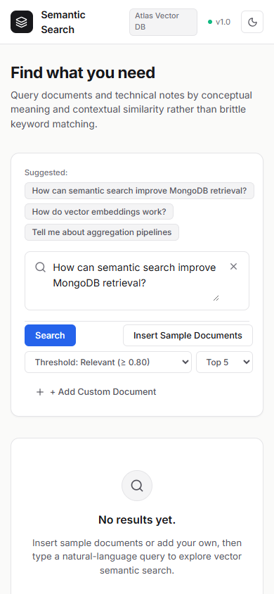
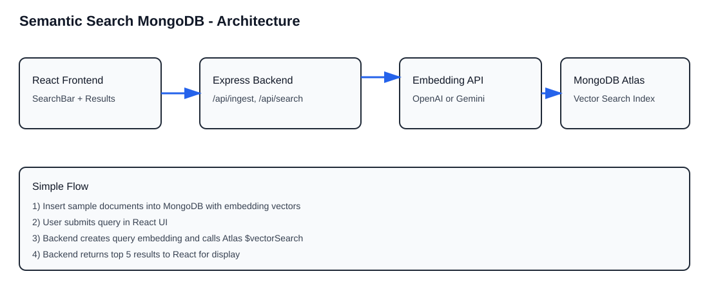
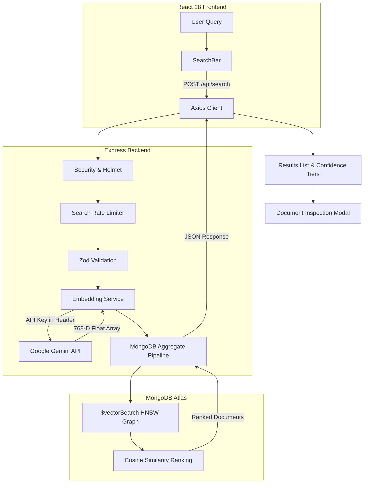

# Semantic Search Engine

A full-stack semantic search engine built with the **MERN stack**, **MongoDB Atlas Vector Search**, and **Google Gemini Embeddings**.

Rather than relying strictly on keyword overlap (lexical matching), this application retrieves documents based on conceptual intent and semantic similarity. By projecting texts into a 768-dimensional vector space, queries match documents that discuss the same concepts even when they share zero identical words.

---

## Overview

Traditional keyword search systems (like basic SQL `LIKE` queries or simple full-text search) struggle when users search with natural language, synonyms, or conceptual questions. A user querying *"how to avoid database downtime during traffic spikes"* might miss an article titled *"horizontal scaling and replica sets"* simply because the exact words do not overlap.

This project solves that limitation using dense vector representations. Text documents and search queries are converted into 768-dimensional embedding vectors using Google's Gemini embedding model. High-dimensional vector indexing in MongoDB Atlas calculates cosine similarity between the query vector and indexed document vectors, returning conceptually relevant results ranked by similarity score.

The application includes a search-first workspace inspired by Linear and Raycast, complete with real-time confidence grading, similarity progress meters, document detail inspection, a custom knowledge ingestion drawer, and an honest zero-results state when queries fall below calibrated relevance thresholds.

---

## Key Features

- **Semantic Vector Retrieval**: Performs approximate nearest neighbor (ANN) search over 768-dimensional embeddings using MongoDB Atlas native `$vectorSearch` and Hierarchical Navigable Small World (HNSW) graphs.
- **Calibrated Relevance Tiers**: Filters results using a cosine similarity threshold (defaulting to $\ge 0.80$) to distinguish true conceptual matches from baseline embedding noise (~0.73 noise floor).
- **Document Detail Modal**: Dedicated reading dialog (`DocumentPreviewModal`) displaying full document content, vector similarity breakdown, and formatted JSON metadata.
- **Knowledge Ingestion Pipeline**: Ingest single or batched documents with automatic vector generation and database persistence, supported by an expandable in-app ingestion drawer.
- **Dual-Tiered Rate Limiting**: Built-in Express rate limiters (30 requests/min for search; 10 requests/min for ingestion) to protect free-tier Gemini API quotas and database resources.
- **Strict Input Validation**: Zod runtime schema validation on all API endpoints sanitizes payloads, clamps result limits (1–20), and validates document structures.
- **System-Aware Theme System**: Full light (`#FAFAF9`) and dark (`#111113`) theme modes with immediate toggle feedback, `localStorage` persistence, and `prefers-color-scheme` fallback.
- **End-to-End Test Suite**: 37 automated unit and integration tests across backend (Vitest + Supertest) and frontend (Vitest + React Testing Library + JSDOM).

---

## Screenshots

### Light Mode Workspace

*Linear-inspired search workspace showing prompt suggestion chips, relevance threshold selectors, and pre-filled natural language query.*

### Dark Mode Workspace

*Dark theme interface showing high-contrast typography, restrained neutral surfaces, and clean borders.*

### Mobile Responsive Layout
<p align="center">
  
</p>
*Fluid, responsive mobile interface preserving full access to search controls, theme toggling, and ingestion drawers.*

---

## How It Works

<p align="center">
  
</p>

### End-to-End Pipeline



1. **Query Entry**: The user enters a natural language query or selects a suggested technical prompt.
2. **Request Validation**: The Express backend enforces rate limits (30 req/min) and parses the payload against a strict Zod schema (`query` must be non-empty; `limit` clamped between 1 and 20; `minScore` validated).
3. **Query Vectorization**: The backend calls the Google Gemini embedding endpoint (`:embedContent`), authenticating via `x-goog-api-key` headers to generate a 768-dimensional float vector.
4. **Vector Search Pipeline**: MongoDB Atlas executes an aggregation pipeline with the `$vectorSearch` stage, matching the query vector against pre-indexed document vectors via cosine distance on an HNSW index graph.
5. **Relevance Thresholding**: The backend filters candidate results by `minScore` (default: 0.80) to eliminate irrelevant documents that cluster around the natural language baseline.
6. **Result Presentation**: React renders ranked matches with color-coded confidence badges, similarity meters, metadata pills, and an action to inspect the full document in a modal.

---

## Technology Stack

| Layer | Technology | Version | Purpose in this Project |
| :--- | :--- | :--- | :--- |
| **Frontend Framework** | React | `^18.2.0` | Component-based user interface with hooks for search and theme state. |
| **Build Tool** | Vite | `^6.4.1` | Fast local development server and optimized production bundler. |
| **Styling** | Vanilla CSS Tokens | Custom | Design tokens with CSS variables for light/dark modes, 4px/8px spacing grid, and fluid typography. |
| **Icons** | Lucide React | `^1.60.0` | Consistent, accessible SVG iconography. |
| **Backend Framework** | Express.js | `^4.18.2` | RESTful API server handling search, ingestion, and health checks. |
| **Database** | MongoDB Node Driver | `^6.12.0` | Native Atlas database connection with connection pooling. |
| **Vector Search** | Atlas Vector Search | Native | Approximate nearest neighbor (ANN) vector indexing with HNSW graphs. |
| **AI / Embeddings** | Google Gemini API | `gemini-embedding-001` | Generates 768-dimensional dense vector embeddings. |
| **Schema Validation** | Zod | `^4.6.7` | Runtime type safety and payload sanitization on incoming requests. |
| **Security & Limits** | Helmet & express-rate-limit | `^8.3.0` / `^8.7.1` | HTTP security headers and IP-based rate limiting to protect API quotas. |
| **Test Runners** | Vitest & Supertest | `^5.0.5` / `^7.3.1` | Hermetic unit, integration, and mock testing across backend and frontend. |

---

## Architecture and Project Structure

```text
.
├── package.json                     # Monorepo convenience scripts (test, dev, build)
├── .github/workflows/ci.yml         # GitHub Actions CI for Node 18 & 20
├── docs/
│   ├── architecture-diagram.svg     # Vector search architecture visual
│   └── screenshots/                 # Application screenshots
├── backend/
│   ├── .env.example                 # Template for required environment variables
│   ├── app.js                       # Express configuration, CORS, Helmet, routes
│   ├── server.js                    # Server entry, Atlas connection, graceful shutdown
│   ├── middleware/
│   │   ├── rateLimiter.js           # Rate limiting for search and ingest endpoints
│   │   └── validate.js              # Zod validation schemas and middleware factory
│   ├── routes/
│   │   └── search.js                # POST /api/search and POST /api/ingest routes
│   ├── services/
│   │   └── embeddingService.js      # Gemini API client (single & chunked batching)
│   ├── scripts/
│   │   └── seed.js                  # Database seeder with sample technical documents
│   └── tests/
│       ├── embeddingService.test.js # Unit tests for embedding service & error wrapping
│       ├── health.test.js           # GET /health integration test
│       └── search.test.js           # Search & Ingest API contract tests
└── frontend/
    ├── index.html                   # HTML entry point with web font imports
    ├── vite.config.js               # Vite config with React plugin and test runner
    ├── src/
    │   ├── main.jsx                 # React root mount point
    │   ├── App.jsx                  # Main application state and layout orchestrator
    │   ├── AppHeader.jsx            # Header with brand identity, version, theme toggle
    │   ├── SearchBar.jsx            # Search textarea, prompt chips, threshold selector
    │   ├── Results.jsx              # Result list, confidence tiers, loading skeletons
    │   ├── DocumentPreviewModal.jsx # Reading modal for full text and JSON metadata
    │   ├── ThemeToggle.jsx          # Theme switch with localStorage persistence
    │   ├── api.js                   # Axios client for backend communication
    │   ├── index.css                # CSS variables, typography, and component styling
    │   └── test-setup.js            # JSDOM matchMedia mock & jest-dom setup
    └── src/__tests__/
        ├── SearchBar.test.jsx       # Isolated unit tests for SearchBar
        ├── Results.test.jsx         # Isolated unit tests for Results
        └── AppIntegration.test.jsx  # Full DOM integration tests covering search flows
```

---

## Getting Started

Follow these steps to clone, configure, seed, and run the project locally.

### Prerequisites

- **Node.js**: `v18.0.0` or higher (`node -v`)
- **npm**: `v9.0.0` or higher
- **MongoDB Atlas Cluster**: A free M0 cluster or higher ([MongoDB Atlas](https://www.mongodb.com/atlas))
- **Google Gemini API Key**: Free API key from [Google AI Studio](https://aistudio.google.com/)

---

### Step 1: Clone the Repository

```bash
git clone https://github.com/MrNasrulla15/Semantic-Search-MongoDB.git
cd Semantic-Search-MongoDB
```

### Step 2: Configure Backend Environment

Copy the example environment file in `backend/`:

```bash
cp backend/.env.example backend/.env
```

Open `backend/.env` and supply your actual credentials:

```env
PORT=5000
MONGODB_URI=mongodb+srv://<username>:<password>@cluster0.mongodb.net/semantic_search?retryWrites=true&w=majority
VECTOR_INDEX_NAME=vector_index
GEMINI_API_KEY=your_actual_gemini_api_key_here
GEMINI_EMBEDDING_MODEL=gemini-embedding-001
CORS_ORIGIN=http://localhost:5173
NODE_ENV=development
```

> **Security Note**: Never commit `backend/.env` to source control. It is already included in `.gitignore`.

---

### Step 3: Install Dependencies

You can install all dependencies from the root directory or inside each subfolder:

```bash
# Install backend dependencies
cd backend && npm install

# Install frontend dependencies
cd ../frontend && npm install
cd ..
```

---

### Step 4: Configure MongoDB Atlas Vector Search Index

1. Log into your [MongoDB Atlas Dashboard](https://cloud.mongodb.com/).
2. Under **Deployment** $\rightarrow$ **Database**, click **Browse Collections**.
3. Locate the database `semantic_search` and collection `searchdocuments` (if not created yet, run the seed script below or create it manually).
4. Go to the **Atlas Search** tab $\rightarrow$ click **Create Search Index**.
5. Select **JSON Editor** under **Atlas Vector Search**.
6. Select collection `semantic_search.searchdocuments`.
7. Set the **Index Name** to `vector_index` (matching `VECTOR_INDEX_NAME` in `.env`).
8. Paste the following index definition:

```json
{
  "fields": [
    {
      "type": "vector",
      "path": "embedding",
      "numDimensions": 768,
      "similarity": "cosine"
    }
  ]
}
```

9. Click **Next** $\rightarrow$ **Create Search Index**. The index status will show *Building* and change to *READY* in 1–2 minutes.

---

### Step 5: Seed Sample Documents

Run the database seeder to generate Gemini embeddings for sample technical documents and insert them into MongoDB:

```bash
npm run seed
# or: cd backend && node scripts/seed.js
```

---

### Step 6: Start the Development Servers

Open two terminal windows:

**Terminal 1 — Backend API Server:**
```bash
cd backend
npm run dev
# Server ready at http://localhost:5000
```

**Terminal 2 — Frontend Development Server:**
```bash
cd frontend
npm run dev
# Vite dev server ready at http://localhost:5173
```

Open **`http://localhost:5173`** in your browser.

---

## Environment Variables Reference

| Variable Name | Required | Default | Description |
| :--- | :---: | :---: | :--- |
| `PORT` | No | `5000` | Port for the Express backend server. |
| `MONGODB_URI` | **Yes** | — | Full MongoDB Atlas connection string with credentials and database name. |
| `VECTOR_INDEX_NAME` | No | `vector_index` | Name of the Atlas Vector Search index configured in the Atlas UI. |
| `GEMINI_API_KEY` | **Yes** | — | Google Gemini API key used to generate vector embeddings. |
| `GEMINI_EMBEDDING_MODEL` | No | `gemini-embedding-001` | Embedding model identifier. Produces 768-D vectors. |
| `EMBEDDING_DIMENSIONS` | No | `768` | Dimension count for output vectors. Must match Atlas index `numDimensions`. |
| `CORS_ORIGIN` | No | `http://localhost:5173` | Comma-separated list of allowed frontend origins for CORS. |
| `NODE_ENV` | No | `development` | Set to `production` in production to suppress internal error stack traces. |

---

## Usage Guide

1. **Submit a Search**:
   - Type a question into the query box (e.g., *"How do vector embeddings work?"*).
   - Press `Enter` or click **Search**.
   - The system displays animated skeleton loaders while generating query vectors and querying Atlas.
2. **Interpret Similarity Scores**:
   - **High Relevance** ($\ge 0.85$, emerald badge): Strong conceptual alignment with direct topical overlap.
   - **Moderate Relevance** ($0.80 - 0.8499$, blue badge): Related technical context.
   - **Weak Match** ($0.75 - 0.7999$, amber badge): Distant association.
   - **Noise Floor** ($< 0.75$): Filtered out by default to maintain semantic honesty.
3. **Inspect Document Details**:
   - Click the **Inspect** button on any result card.
   - The modal shows the full un-truncated text, exact cosine similarity score, and formatted metadata JSON.
   - Press `Escape` or click **Done** to close.
4. **Honest No-Results Handling**:
   - If you search for an out-of-domain topic (e.g., *"baking chocolate cake and sourdough bread"*), the system returns 0 results and displays clear guidance explaining that no documents met the relevance threshold.
5. **Add Custom Documents**:
   - Click **+ Add Custom Document** in the search actions bar.
   - Enter a title, content, and category tag.
   - Click **Save & Embed** to immediately vectorize and store your custom note in MongoDB Atlas.

---

## API Documentation

### 1. Health Check

```http
GET /health
```

**Response (200 OK):**
```json
{
  "status": "ok"
}
```

---

### 2. Semantic Search

```http
POST /api/search
Content-Type: application/json
```

**Request Body:**
```json
{
  "query": "How can semantic search improve MongoDB retrieval?",
  "limit": 5,
  "minScore": 0.80
}
```

**Response (200 OK):**
```json
{
  "query": "How can semantic search improve MongoDB retrieval?",
  "count": 2,
  "totalCandidates": 5,
  "minScore": 0.8,
  "results": [
    {
      "id": "6ad75d29662997b4991d359b",
      "title": "MongoDB Atlas Vector Search Architecture",
      "content": "MongoDB Atlas Vector Search enables native vector indexing alongside transactional operational data...",
      "metadata": {
        "category": "database",
        "topic": "vector-search"
      },
      "score": 0.8953,
      "confidence": "high"
    }
  ]
}
```

**Error Responses:**
- `400 Bad Request`: When `query` is empty or missing (`{"message": "query must be a non-empty string"}`).
- `429 Too Many Requests`: When the IP exceeds 30 searches per minute.
- `503 Service Unavailable`: When the Atlas Vector Search index is not yet built or cannot be found.

---

### 3. Document Ingestion

```http
POST /api/ingest
Content-Type: application/json
```

**Request Body:**
```json
{
  "documents": [
    {
      "title": "React 18 Concurrent Rendering",
      "content": "React 18 introduced automatic batching and Transitions with useTransition...",
      "metadata": { "category": "frontend" }
    }
  ]
}
```

**Response (201 Created):**
```json
{
  "insertedCount": 1
}
```

**Error Responses:**
- `400 Bad Request`: If `documents` is empty or any document lacks non-empty content.
- `429 Too Many Requests`: When exceeding 10 ingest requests per minute.

---

## Testing & Verification

The project includes unit and integration tests across both frontend and backend using Vitest. Dependency injection in Express routes allows backend tests to execute hermetically without real network calls to Gemini or MongoDB.

### Run All Tests (Root Monorepo)

```bash
npm test
```

### Run Tests Individually

```bash
# Run backend tests (16 tests)
npm --prefix backend test

# Run frontend tests (21 tests)
npm --prefix frontend test
```

### Test Coverage Breakdown

- **Backend Tests (16 tests)**:
  - `embeddingService.test.js`: Single embedding, chunked batching (50 texts/batch), auth header validation, error wrapping.
  - `health.test.js`: HTTP 200 health check response.
  - `search.test.js`: Payload schema validation, empty query rejection, limit clamping (max 20), ranked results mapping, empty results.
- **Frontend Tests (21 tests)**:
  - `SearchBar.test.jsx`: Textarea binding, sample document ingestion trigger, search submission, loading disabled states.
  - `Results.test.jsx`: Score formatting to 4 decimals, untitled document fallbacks, list item rendering, empty state.
  - `AppIntegration.test.jsx`: Full DOM integration testing theme toggling, `localStorage` persistence, loading skeleton states, modal inspection, honest zero-results guidance, error banner presentation, and custom knowledge ingestion.

### Production Bundle Verification

```bash
npm --prefix frontend run build
# Compiles production bundle in dist/ with zero errors
```

---

## Known Engineering Considerations & Trade-offs

1. **Embedding Baseline Anisotropy (The ~0.73 Noise Floor)**:
   Dense natural language embeddings in 768-D vector space often cluster within a narrow cone. As a result, two completely unrelated English sentences (e.g., *"baking bread"* vs *"MongoDB indexing"*) typically register a cosine similarity of ~`0.70 - 0.74`. To prevent unrelated documents from appearing as valid results, the search interface enforces a default threshold of `0.80`.
2. **Atlas Vector Search Provisioning**:
   Atlas Vector Search indexes must be defined in the MongoDB Atlas Cloud UI or via the Atlas Admin API. The application includes graceful 503 error handling to notify developers if the index has not finished building.
3. **Chunking & Document Size**:
   The current ingestion route embeds the combined `${title}\n${content}` string. For long-form documents exceeding Gemini's token window, implementing recursive character chunking (e.g., 500-token chunks with 50-token overlap) is recommended for production scale.

---

## Security Practices

- **Header-Based Authentication**: The Gemini API key is transmitted via `x-goog-api-key` headers rather than exposed in query strings or frontend code.
- **Defensive HTTP Headers**: Express uses `helmet` to set secure HTTP headers (e.g., `X-Content-Type-Options`, `X-Frame-Options`).
- **Origin Whitelisting**: Strict CORS origin validation restricts API access to explicit frontend domains defined in `CORS_ORIGIN`.
- **Rate Limiting**: IP-based rate limiting prevents denial-of-service abuse and protects third-party API quotas.
- **Zero Secrets in Repository**: Sensitive values are isolated in `.env` and excluded from git tracking.

---

## Future Roadmap

- [ ] **Hybrid Search (BM25 + Dense Vectors)**: Combine lexical keyword scoring with vector similarity via Reciprocal Rank Fusion (RRF) for better retrieval on exact acronyms and part numbers.
- [ ] **Recursive Text Chunking**: Automatic document segmentation with token overlap for multi-page PDF/Markdown uploads.
- [ ] **Query Result Caching**: In-memory Redis or LRU cache for frequent query embeddings to lower latency and API cost.
- [ ] **Document Deletion & Editing**: Management UI for updating or removing existing documents from the vector collection.

---

## Author & License

- **Author**: Nasrulla ([@MrNasrulla15](https://github.com/MrNasrulla15))
- **License**: Distributed under the [MIT License](LICENSE).
